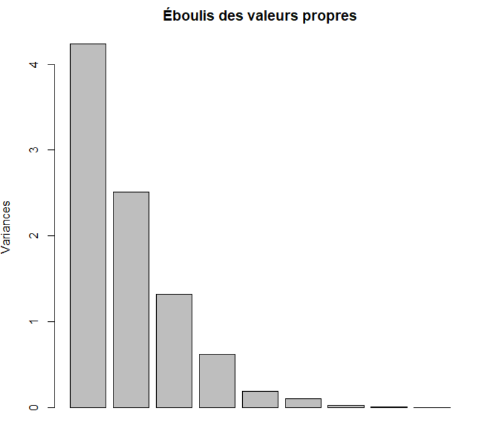
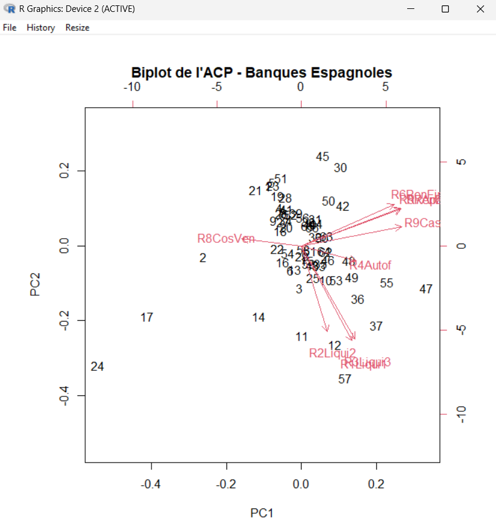
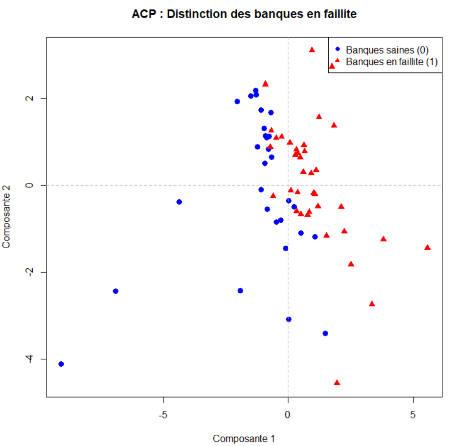
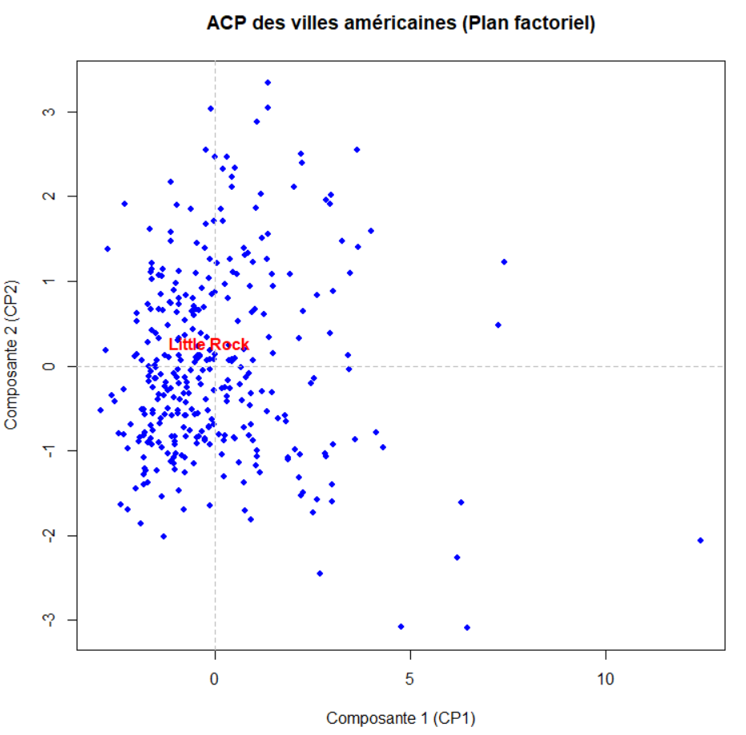

# TP2

## Exercice 1

### Le fichier bankFailures est un tableau avec la première ligne 12 libbélés différent. Le fichier comporte 67 lignes, il y a donc 66 banques différentes, la première colonne est donc une premiere ligne avec l'entete "numéro" et ensuite 66 lignes numérotées.

### La colonnes ne comporte pas uniquement des données chiffrées mais aussi des dates, il faut nettoyer la colonne R8CosVen
### /!\ Comment fonctionne les commandes de nettoyage de données utilisées ?  

### première ligne: bank$R8CosVen cible la colonne R8CosVen, as.numeric force a convertir toutes les valeurs de la colonne en valeur numériques (les dates sont converties en valeur manquantes/inconnue), suppressWarnings(...) sert à supprimer les messages d'erreur que la commande as.numeric genere (En R losque que des valeurs inconnue sont générées un message de warning est envoyé).
### deuxième ligne:  puisque la ligne précédentes a rajoutée des NA dans les valeurs, il faut les modifier car l'ACP ne supporte pas les NA. is.na(bank$R8CosVen) repère les valeurs NA et median(bank$R8CosVen, na.rm = TRUE) remplace ces valeurs NA par la médianne de toute la colonne (sans les NA)

### On ne garde que les colonnes 3 à 11 pour l'ACP 
### Pour l'ACP on est obligé de centrée et reduire car si l'on ne faisait pas ça avec les différentes échelles certaines composantes écraserait totalement les autres.

### La variance expliquée calcul quel pourcentage de l'information totale que chaque axe de l'acp représente.

### On peut ensuite afficher le plot des valeurs propres

### On calcul ensuite le centre de gravité

### Sur le graphique, deux banques proches auront un profil financier similaire, les fléches representent un ratio financier: la direction et la longueur de la flèche indiquent comment cette variable contribue aux axes tandis que l'angle entre les flèches montre la corrélation entre les variables (des flèches rapprochées pointant dans la même direction sont fortement corrélées positivement).

### En mettant les banques en faillites et celles qui ne le sont pas en evidence, on remarque que les banques en faillites sont plutot dans les positifs de l'axe 1 tandis que celle qui ne le sont pas sont dans les negatifs

## Exercice 2

### Sans standardisation, les deux premier axes captent 89% de l'information mais ce qui est artificiel vu la manque de standardisation (les grosses valeurs numériques emportent tout)
### Avec la standardisation les deux premiers axes captent 51%

### L'Axe 1 classe les villes de la petite bourgade calme et bon marché vers la grande métropole riche, culturelle et chère. L'Axe 2 affine le profil en distinguant la ville universitaire/institutionnelle de la ville de loisirs/économique.

### Si je devais choisir une ville je choirais surement Little Rock car elle se trouve dans l'extreme centre qui sont des villes de taille intermédiaire, très stables, qui combinent un coût du logement modéré, une bonne tranquillité (loin de la criminalité) et une economie/loisirs assez developpé.

